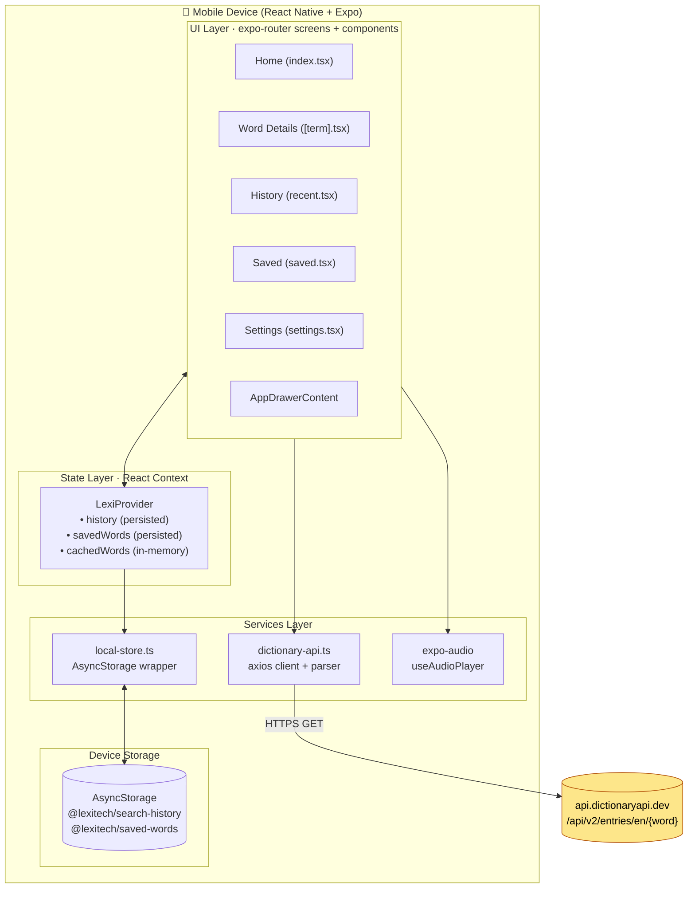
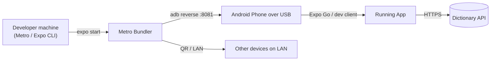

# 02 — Architecture

The app is a single React Native client with no custom backend. State is local; the only network dependency is the Free Dictionary API.

## Layered view

## Module responsibilities

| Layer | Module | Responsibility |
|---|---|---|
| UI | [`src/app/*`](../src/app), [`src/components/*`](../src/components) | Screens + reusable components. Pulls data from context, dispatches actions. Owns no business logic. |
| State | [`src/providers/lexi-provider.tsx`](../src/providers/lexi-provider.tsx) | Single React Context. Owns history, saved words, in-memory cache. Hydrates from AsyncStorage on mount. |
| Services — API | [`src/services/dictionary-api.ts`](../src/services/dictionary-api.ts) | axios client. Builds URL, parses JSON into normalized `WordEntry`, throws typed `DictionaryApiError`. |
| Services — Storage | [`src/services/local-store.ts`](../src/services/local-store.ts) | Thin, corruption-tolerant wrapper around `AsyncStorage`. |
| Services — Audio | `expo-audio` consumed in `[term].tsx` | Loads + plays the pronunciation MP3, tracks play/pause/stop. |
| Routing | [`src/app/_layout.tsx`](../src/app/_layout.tsx) | `expo-router` Drawer, registers all screens, sets up `GestureHandlerRootView` + `SafeAreaProvider`. |

## Why this shape

- **No state library** — Context + local state is enough for this scope; saves ~50 KB of JS and an extra dependency.
- **Services are pure modules** — no React imports, so they're trivially unit-testable.
- **Single error type** with a discriminated `kind` field — UI branches deterministically, not by string matching.
- **One Context, not many** — avoids provider tree-walks; everything related to a word (history/saved/cache) is co-located.

## Build & run topology

