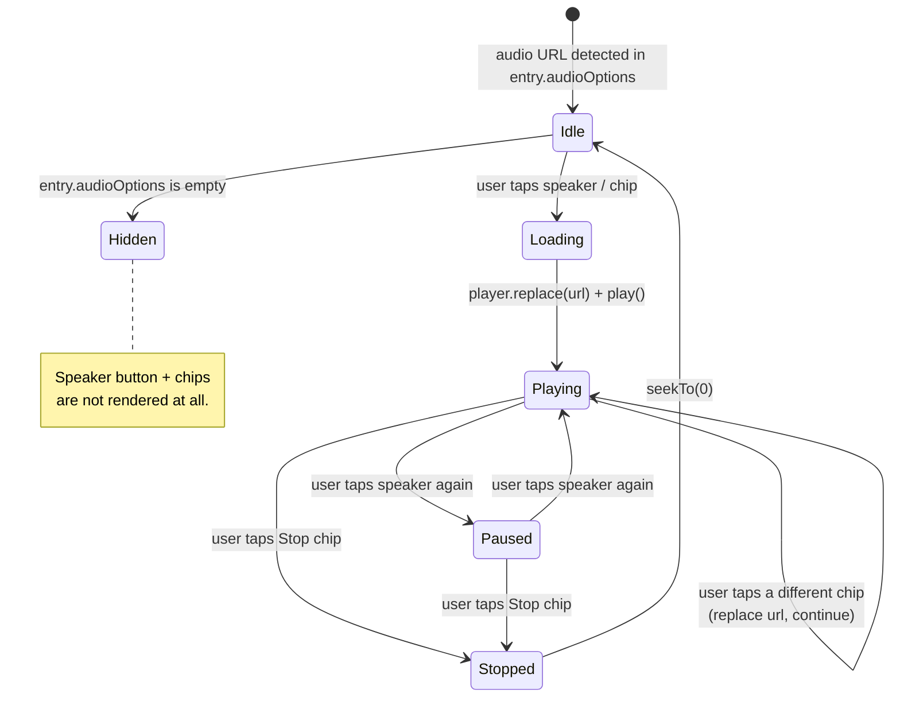
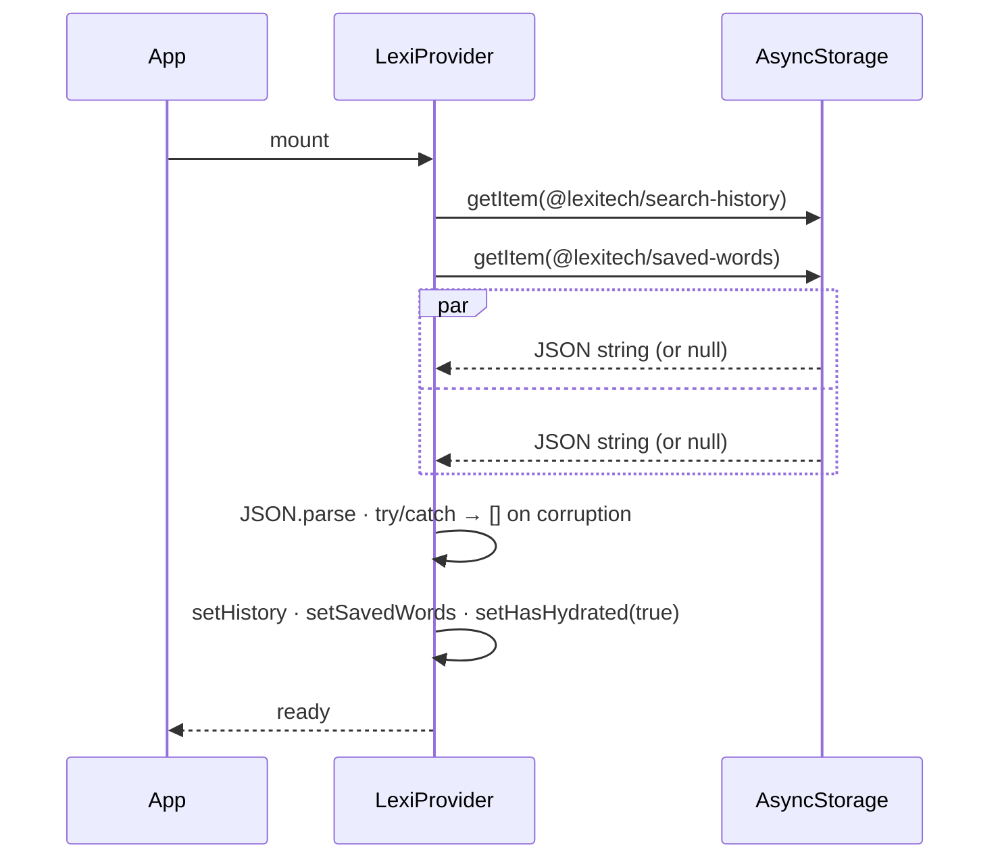

# 03 — Data Flow Diagrams

Each user-facing interaction is shown as a sequence diagram. Actors:

- **User** — the human tapping the screen.
- **Home / Details / Drawer** — screen components (`src/app/*`).
- **Context** — `LexiProvider` state.
- **API** — `dictionary-api.ts` (axios client).
- **Storage** — `local-store.ts` + AsyncStorage.
- **External** — `api.dictionaryapi.dev`.

---

## 3.1 Successful word search

```mermaid
---
id: a2b22c39-d97d-4142-bca6-71ba84d1a148
---
sequenceDiagram
    actor User
    participant Home
    participant Router
    participant Details
    participant Context
    participant API
    participant Ext as Dictionary API

    User->>Home: type "education"
    User->>Home: tap Search
    Home->>Home: validate non-empty ✓
    Home->>Router: router.push(/word/education)
    Router->>Details: mount with term="education"
    Details->>Context: getCachedWord("education")
    Context-->>Details: undefined (miss)
    Details->>Details: setLoading(true) → render skeleton
    Details->>API: fetchWordEntry("education")
    API->>Ext: GET /api/v2/entries/en/education
    Ext-->>API: 200 OK + JSON[]
    API-->>Details: WordEntry (normalized)
    Details->>Context: cacheWord(entry)
    Details->>Context: addHistoryItem(summary)
    Context->>Storage: saveSearchHistory(items)
    Details->>Details: setLoading(false) → render details
    Details-->>User: word, phonetic, meanings, audio
```

---

## 3.2 Word not found (HTTP 404)

```mermaid
sequenceDiagram
    actor User
    participant Home
    participant Details
    participant API
    participant Ext as Dictionary API

    User->>Home: type "xyzabc"
    Home->>Details: router.push(/word/xyzabc)
    Details->>API: fetchWordEntry("xyzabc")
    API->>Ext: GET /api/v2/entries/en/xyzabc
    Ext-->>API: 404 Not Found
    API-->>Details: throw DictionaryApiError(kind:"not-found")
    Details->>Details: setError({kind:"not-found"})<br/>setLoading(false)
    Details-->>User: "Word not found" screen<br/>(sad face · Search Again · OR · Suggest a word · Quick Tips)
```

---

## 3.3 Network failure

```mermaid
sequenceDiagram
    actor User
    participant Details
    participant API
    participant Ext as Dictionary API

    User->>Details: open word (or Retry)
    Details->>API: fetchWordEntry("etymology")
    API->>Ext: GET ...
    Ext--xAPI: (no response — offline / timeout)
    API-->>Details: throw DictionaryApiError(kind:"network")
    Details-->>User: Connection problem screen<br/>(CURRENT SEARCH card · cloud-off · Retry · Check Settings · Offline Access)
    User->>Details: tap Retry
    Details->>Details: reloadToken++ → effect re-runs
    Details->>API: fetchWordEntry("etymology")
    API->>Ext: GET ...
    Note over Ext,API: succeeds on retry
    Ext-->>API: 200 OK
    API-->>Details: WordEntry
    Details-->>User: details view
```

---

## 3.4 Open a word from drawer history

```mermaid
sequenceDiagram
    actor User
    participant Drawer
    participant Details
    participant Context
    participant API

    User->>Drawer: open drawer
    Drawer->>Context: read history
    Context-->>Drawer: [recent items]
    User->>Drawer: tap "kigali"
    Drawer->>Drawer: closeDrawer()
    Drawer->>Details: router.push(/word/kigali)
    Details->>Context: getCachedWord("kigali")
    alt cache hit (same session)
        Context-->>Details: WordEntry
        Details-->>User: render immediately
    else cache miss (e.g. after restart)
        Context-->>Details: undefined
        Details->>API: fetchWordEntry("kigali")
        API-->>Details: WordEntry
        Details->>Context: cacheWord + addHistoryItem
        Details-->>User: render details
    end
```

---

## 3.5 Audio playback



---

## 3.6 App boot / hydration


