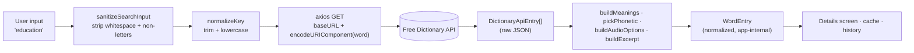

# 04 — API Endpoints

There is **one** external endpoint, exposed by the Free Dictionary API. The app exposes **no** custom endpoints — there is no backend.

## 4.1 External endpoint

| | |
|---|---|
| **Method** | `GET` |
| **URL** | `https://api.dictionaryapi.dev/api/v2/entries/en/{word}` |
| **Auth** | none |
| **Path params** | `word` — the English word to look up; URL-encoded by the client |
| **Success** | `200 OK` + JSON array of entries |
| **Failure — no match** | `404 Not Found` |
| **Failure — offline / timeout** | no response (axios `error.response === undefined`) |
| **Failure — other** | non-2xx with arbitrary body |

### URL construction

```ts
// src/services/dictionary-api.ts
const dictionaryClient = create({
  baseURL: 'https://api.dictionaryapi.dev/api/v2/entries/en/',
  timeout: 15000,
});

// per request — encodeURIComponent guards against odd chars
await dictionaryClient.get(encodeURIComponent(word));
```

## 4.2 Request → Response → Internal type



## 4.3 Response shape (excerpt)

```jsonc
[
  {
    "word": "education",
    "phonetic": "/ˌɛd.jʊˈkeɪ.ʃən/",
    "phonetics": [
      { "text": "/ˌɛd.jʊˈkeɪ.ʃən/", "audio": "https://api.dictionaryapi.dev/media/.../education-uk.mp3" },
      { "text": "/ˌɛdʒ.əˈkeɪ.ʃən/", "audio": "https://api.dictionaryapi.dev/media/.../education-us.mp3" }
    ],
    "meanings": [
      {
        "partOfSpeech": "noun",
        "definitions": [
          {
            "definition": "The process of receiving or giving systematic instruction…",
            "example": "a new system of public education",
            "synonyms": ["schooling", "teaching"],
            "antonyms": []
          }
        ],
        "synonyms": ["schooling"],
        "antonyms": []
      }
    ],
    "sourceUrls": ["https://en.wiktionary.org/wiki/education"],
    "license": { "name": "CC BY-SA 3.0", "url": "https://..." }
  }
]
```

## 4.4 Internal normalized type

```ts
type WordEntry = {
  key: string;                 // lowercased + trimmed; used as cache and history id
  word: string;
  phonetic?: string;
  audioOptions: AudioOption[]; // {id, label, url} — deduped
  meanings: WordMeaning[];     // partOfSpeech + definitions[] + synonyms/antonyms
  sourceUrls: string[];
  licenseName?: string;
  excerpt: string;             // truncated first definition (for list previews)
  usageExamples: string[];     // up to 3 examples flattened across meanings
  synonyms: string[];          // top 8 unique synonyms
};
```

Defined in [`src/types/dictionary.ts`](../src/types/dictionary.ts).

## 4.5 Error mapping

| axios state | Thrown by API service | Rendered by UI |
|---|---|---|
| `response.status === 404` | `DictionaryApiError("not-found", "We couldn't find \"{word}\"…", 404)` | "Word not found" screen |
| `!error.response` (timeout / DNS / offline) | `DictionaryApiError("network", "We could not reach the dictionary service…")` | "Connection problem" screen |
| other non-2xx | `DictionaryApiError("unexpected", "The dictionary service returned an unexpected response…", status)` | Generic "Unable to load word" |
| `response.data` is empty array | `DictionaryApiError("unexpected", "The dictionary returned an empty response…")` | Generic |
| any other thrown value | `DictionaryApiError("unexpected", "Something went wrong while loading this word…")` | Generic |
