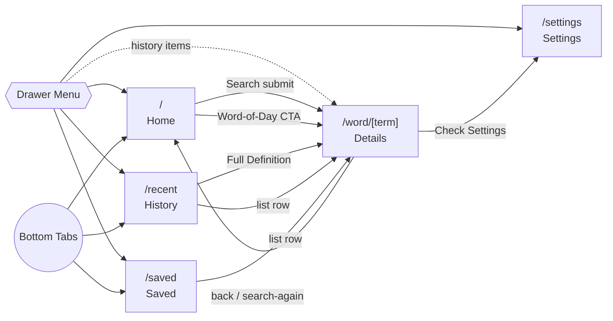
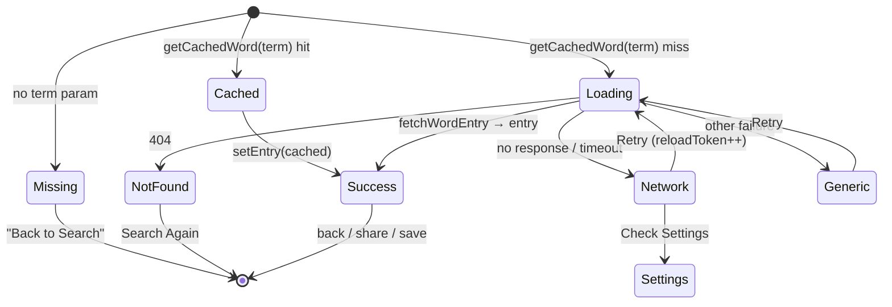

# 05 — Pages & Screens

File-based routing via [`expo-router`](https://docs.expo.dev/router/introduction/), wrapped in a top-level Drawer.

## 5.1 Route map

| Route | File | Drawer label | Purpose |
|---|---|---|---|
| `/` | [`src/app/index.tsx`](../src/app/index.tsx) | Home | Home — two variants depending on history. |
| `/word/[term]` | [`src/app/word/[term].tsx`](../src/app/word/[term].tsx) | hidden | Word details, loading, error states. |
| `/recent` | [`src/app/recent.tsx`](../src/app/recent.tsx) | Recent | Search history (active card + list, or empty state). |
| `/saved` | [`src/app/saved.tsx`](../src/app/saved.tsx) | Saved | Bookmarked words. |
| `/settings` | [`src/app/settings.tsx`](../src/app/settings.tsx) | Settings | Local data counts + clear actions. |

The drawer is configured in [`src/app/_layout.tsx`](../src/app/_layout.tsx); `word/[term]` is registered but hidden from the drawer list.

## 5.2 Navigation graph

## 5.3 Screen states per Figma frame

| Figma frame | Implemented state | Where |
|---|---|---|
| Splash Screen | `expo-splash-screen` configured in `app.json` (background + image) | `app.json:plugins → expo-splash-screen` |
| Home — Search Empty State | First-time variant (illustration + chips) | `index.tsx` when `history.length === 0` |
| Home — Search Validation | Inline `"Please enter a word to search."` under SearchBar | `index.tsx` validation path |
| Home (returning user) | Master Your Language + Word of the Day + Quick Access + quote | `index.tsx` when `history.length > 0` |
| Loading State | Skeleton cards + "SEARCHING DICTIONARY…" + dashed engine ring | `[term].tsx` loading branch |
| Word Details — Success | Title · phonetic · audio · meanings · synonyms · usage | `[term].tsx` entry branch + `MeaningCard` |
| Word Details — Multiple Meanings | Multiple MeaningCards (one per PoS) | `entry.meanings.map(MeaningCard)` |
| Error — Word Not Found | Sad face · Search Again · OR · Suggest a word · Quick Tips | `[term].tsx` `error.kind === 'not-found'` |
| Error — Network Problem | CURRENT SEARCH card · cloud-off · Retry · Check Settings · Offline Access | `[term].tsx` `error.kind === 'network'` |
| Drawer Open | Custom drawer with nav · history · daily word | `AppDrawerContent` |
| History — Active + list | Active search card · history rows | `recent.tsx` populated |
| History — Empty | "No search history yet" + Daily Wisdom + Privacy First | `recent.tsx` empty |
| Saved | Word list rows | `saved.tsx` populated |
| Saved — Empty | "Nothing saved yet" empty card | `saved.tsx` empty |

## 5.4 Lifecycle of `/word/[term]`

