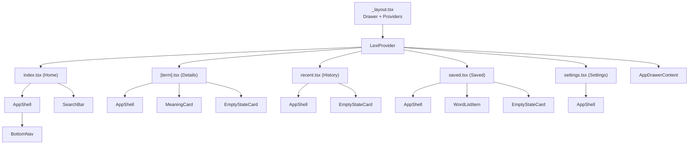

# 06 — Components

All under [`src/components/`](../src/components). Each component is presentational and pulls business state from context where needed.

## 6.1 Inventory

| Component | File | Role |
|---|---|---|
| `AppShell` | [`app-shell.tsx`](../src/components/app-shell.tsx) | Layout primitive — safe-area header (title + left/right actions), scroll container, optional bottom nav. Used by every screen. |
| `BottomNav` | [`bottom-nav.tsx`](../src/components/bottom-nav.tsx) | Explore / Saved / Recent tabs. |
| `SearchBar` | [`search-bar.tsx`](../src/components/search-bar.tsx) | Validated text input + labeled Search button. Sanitizer strips whitespace + non-letters. Inline error row. |
| `MeaningCard` | [`meaning-card.tsx`](../src/components/meaning-card.tsx) | One card per part of speech: PoS badge + numbered definitions + example boxes + source link. |
| `EmptyStateCard` | [`empty-state-card.tsx`](../src/components/empty-state-card.tsx) | Reusable empty / error card: icon + title + description + up to two action buttons. |
| `WordListItem` | [`word-list-item.tsx`](../src/components/word-list-item.tsx) | Compact list row used on the Saved screen. |
| `AppDrawerContent` | [`app-drawer-content.tsx`](../src/components/app-drawer-content.tsx) | Custom drawer body — nav · search history · daily word. |

Supporting primitives (already present in the template) under `src/components/ui/`, `themed-text`, `themed-view`, etc., are kept for compatibility but the Dictionary feature relies on the components above.

## 6.2 Composition graph



## 6.3 Theme tokens

Single source of truth in [`src/constants/lexi-theme.ts`](../src/constants/lexi-theme.ts):

```ts
LexiTheme = {
  colors: { background, surface, surfaceStrong, mint, mintText, mintBadge,
            textPrimary, textBody, textMuted, textSoft, border, danger, ... },
  spacing: { xs:4, sm:8, md:12, lg:16, xl:24, xxl:32 },
  radius:  { sm:8, md:12, lg:20, pill:999 },
}
```

Every component reads from these tokens — no raw hex outside the theme module (except a few illustrative gradients in the home cards).

## 6.4 Patterns

- **`AppShell` wraps every screen** so the header, scroll padding, and bottom nav stay consistent without re-implementing per screen.
- **`EmptyStateCard` is the single canonical empty surface** — used for "No word selected", "No saved words", network error, and generic API error. The not-found screen is intentionally custom because it has additional Quick Tips + OR divider per Figma.
- **`SearchBar` is the single search input** — used on Home in both variants; `compact` prop available for icon-only contexts.
- **`MeaningCard` is pure** — receives a `WordMeaning` plus optional source label/URL. No context access; trivially reusable.
