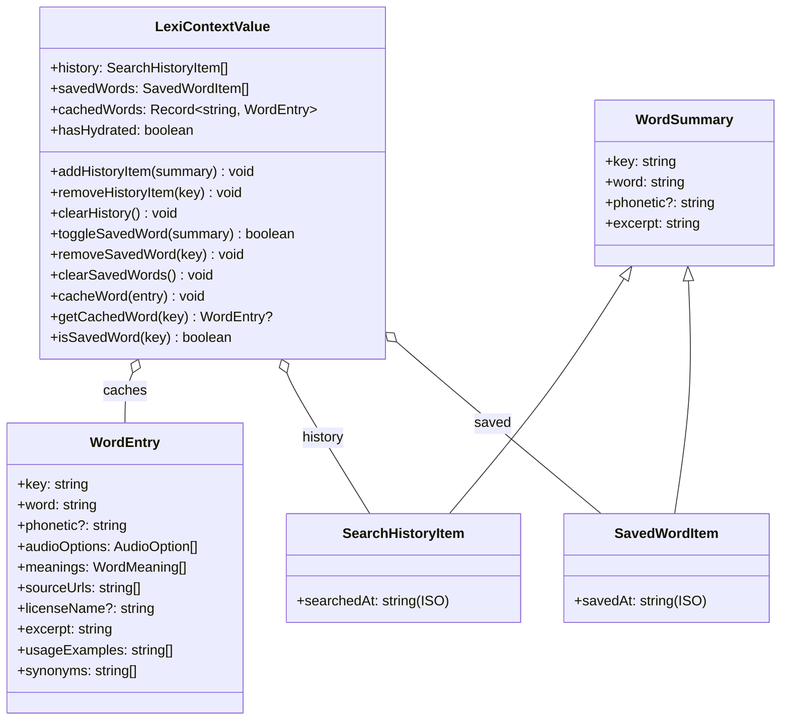
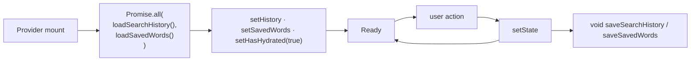

# 07 — State Management

All shared state lives in **`LexiProvider`** — a single React Context. There is no Redux / Zustand / Jotai.

Source: [`src/providers/lexi-provider.tsx`](../src/providers/lexi-provider.tsx).

## 7.1 State shape



## 7.2 Action map

| Action | Effect | Persistence |
|---|---|---|
| `addHistoryItem(summary)` | Upsert by `key`, prepend, cap at 12. **Prevents duplicates.** | writes `@lexitech/search-history` |
| `removeHistoryItem(key)` | Remove single | writes |
| `clearHistory()` | Empty list | writes |
| `toggleSavedWord(summary)` | Bookmark on/off; returns the new boolean state | writes `@lexitech/saved-words` |
| `removeSavedWord(key)` | Remove single | writes |
| `clearSavedWords()` | Empty list | writes |
| `cacheWord(entry)` | Set `cachedWords[entry.key] = entry` | in-memory only |
| `getCachedWord(key)` | Read `cachedWords[key.toLowerCase()]` | in-memory only |
| `isSavedWord(key)` | Pure boolean predicate | — |

## 7.3 Lifecycle



- Hydration is fire-once on mount.
- Writes are fire-and-forget — state updates are synchronous (immediate UI), persistence runs in the background.
- `cachedWords` is intentionally **not** persisted — it's a session-scoped speed-up, not durable data.

## 7.4 Persistence keys

| Key | Type | File |
|---|---|---|
| `@lexitech/search-history` | `SearchHistoryItem[]` (JSON) | [`local-store.ts`](../src/services/local-store.ts) |
| `@lexitech/saved-words` | `SavedWordItem[]` (JSON) | same |

`readJsonValue<T>` wraps `JSON.parse` in `try/catch` and returns `[] as T` on failure, so corrupted local storage never crashes the app.

## 7.5 Deduplication algorithm

```ts
function upsertSummary<T extends { key: string }>(items: T[], incoming: T, limit?: number) {
  const next = [incoming, ...items.filter(it => it.key !== incoming.key)];
  return limit ? next.slice(0, limit) : next;
}
```

- Used by both `addHistoryItem` and `toggleSavedWord`.
- The new item is **prepended**, the old occurrence (if any) is filtered out → no duplicates, most-recent-first ordering.
- `limit = 12` for history; saved words are unbounded.
