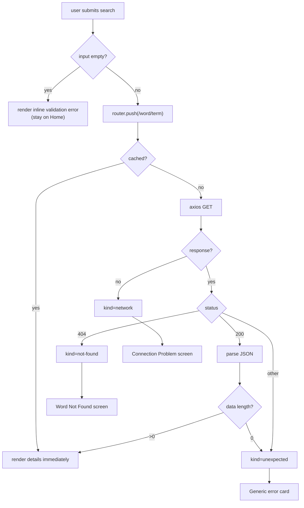

# 08 — Error Handling

Every failure flows through a single typed error class so the UI can branch deterministically.

## 8.1 Error taxonomy

```ts
type DictionaryErrorKind = 'validation' | 'not-found' | 'network' | 'unexpected';

class DictionaryApiError extends Error {
  kind: 'not-found' | 'network' | 'unexpected';
  status?: number;
}
```

| Kind | Source | Trigger | UI |
|---|---|---|---|
| `validation` | UI layer | empty input on submit | Inline error under `SearchBar`: *"Please enter a word to search."* |
| `not-found` | `dictionary-api.ts` | `response.status === 404` | "Word not found" screen (sad face · Search Again · OR · Suggest a word · Quick Tips) |
| `network` | `dictionary-api.ts` | `!error.response` (offline / DNS / timeout) | "Connection problem" screen (CURRENT SEARCH card · cloud-off · Retry · Check Settings · Offline Access tip) |
| `unexpected` | `dictionary-api.ts` | any other non-2xx, empty payload, or thrown value | Generic "Unable to load word" + Retry |

## 8.2 Decision tree



## 8.3 Crash safety

| Hazard | Mitigation |
|---|---|
| API returns empty array | `if (!primaryEntry) throw DictionaryApiError('unexpected', …)` |
| API returns entry with missing `meanings` / `phonetics` | All access via optional chaining + `?? []` defaults |
| Corrupt JSON in AsyncStorage | `readJsonValue` returns `[] as T` on parse failure |
| Unmounted setState | `isMounted` flag on every async effect in `[term].tsx` |
| Long-running request | 15 s axios timeout falls into the `network` branch |
| `useLocalSearchParams` returning `string \| string[] \| undefined` | `Array.isArray(term) ? term[0] : term` normalization |
| Missing audio URL | Speaker icon + chip list are conditionally rendered — never accessed when absent |
| User taps Retry repeatedly | Effect uses `reloadToken` dependency, not parallel calls — each click triggers a single re-run |

## 8.4 Retry semantics

- **Network / unexpected**: `Retry` button → `setReloadToken(c => c + 1)` → effect re-fires → new `fetchWordEntry` call.
- **Not found**: `Search Again` and `Suggest a word` route back to `/` so the user can refine the query.
- **Validation**: no retry needed; user just types and resubmits.

## 8.5 User feedback channels

| Channel | When |
|---|---|
| Inline error row under `SearchBar` | Validation, before any network call |
| Skeleton loading state | While `loading === true` (never coexists with an error) |
| Full-screen error card | Any kind of API failure |
| Empty state cards | When data sets are empty (no history, no saved words, missing word param) |
| `Alert.alert` confirmation | Destructive actions: clear history, clear saved words |
